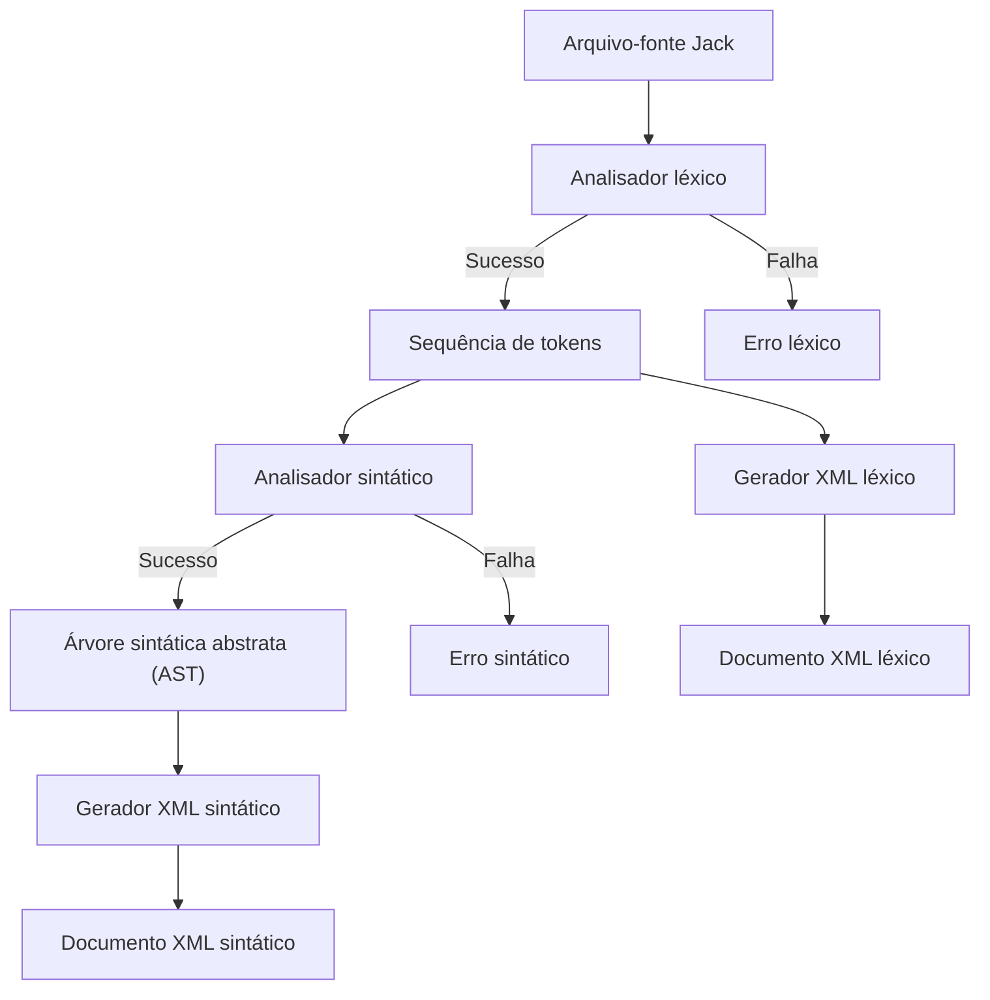
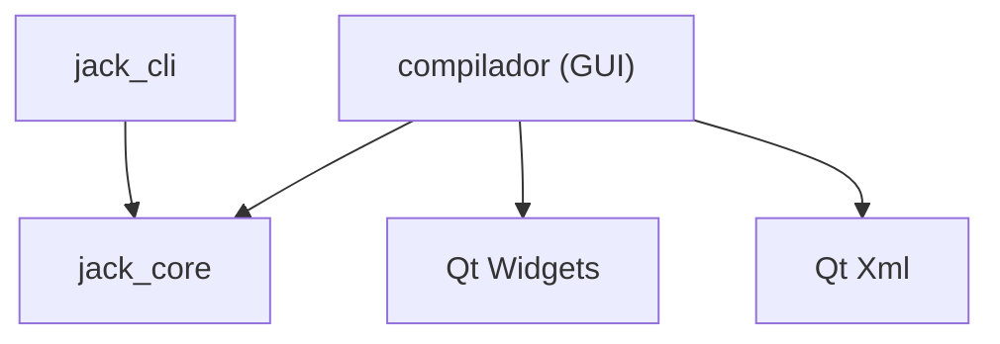

# Arquitetura do JackCompiler

## 1. Objetivo e escopo

Este documento descreve a organização interna do **JackCompiler**, suas principais responsabilidades, os componentes que participam do processamento de um arquivo Jack e as relações entre eles.

O projeto implementa as etapas de **análise léxica**, **análise sintática**, construção de uma **árvore sintática abstrata (AST)** e geração de representações em **XML**. A aplicação oferece duas interfaces de acesso ao mesmo núcleo de processamento: uma interface gráfica, desenvolvida com Qt, e uma interface de linha de comando.

É importante delimitar o escopo: o projeto não implementa análise semântica nem geração de código para a máquina virtual (VM). Portanto, ele reconhece a estrutura léxica e sintática do código e produz representações intermediárias em XML, mas não realiza todas as etapas de um compilador Jack completo.

## 2. Visão geral da arquitetura

A arquitetura separa o processamento da linguagem das interfaces utilizadas para acioná-lo:

- **`core`**: contém a implementação compartilhada do analisador léxico, do analisador sintático, da AST e dos geradores XML.
- **`cli`**: implementa a interface de linha de comando e utiliza o núcleo compartilhado.
- **`src`**: implementa a interface gráfica Qt e também utiliza o núcleo compartilhado.
- **`tests`**: contém arquivos Jack organizados em categorias para a execução dos testes funcionais por lote.

A biblioteca `jack_core` concentra a lógica de processamento. Tanto `jack_cli` quanto `compilador` dependem dela, evitando manter implementações distintas dos analisadores para cada interface.



As interfaces CLI e GUI são responsáveis por apresentar os resultados, receber entradas do usuário e solicitar operações ao núcleo. A geração dos tokens, a análise sintática, a construção da AST e a geração dos documentos XML pertencem ao `core`.

## 3. Organização do repositório

A estrutura relevante do projeto é organizada da seguinte maneira:

```text
JackCompiler/
├── assets/
├── cli/
│   ├── include/jack/cli/
│   └── src/
├── core/
│   ├── include/jack/
│   │   ├── ast/
│   │   ├── lexer/
│   │   ├── parser/
│   │   └── xml/
│   └── src/
│       ├── ast/
│       ├── lexer/
│       ├── parser/
│       └── xml/
├── docs/
├── src/
├── tests/
│   └── inputs/
│       ├── invalidos/
│       └── validos/
└── CMakeLists.txt
```

### 3.1 Núcleo (`core`)

O diretório `core` é dividido por responsabilidade:

| Diretório | Responsabilidade |
|---|---|
| `ast` | Declaração e implementação dos nós da árvore sintática abstrata |
| `lexer` | Representação dos tokens e análise léxica |
| `parser` | Resultado da análise sintática e reconhecimento da gramática |
| `xml` | Geração das representações XML léxica e sintática |

Os diretórios `include` e `src` separam as interfaces públicas das implementações. Os cabeçalhos públicos ficam em `core/include/jack`, enquanto as implementações correspondentes ficam em `core/src`.

### 3.2 Interfaces

O diretório `cli` contém a aplicação de terminal, incluindo menu, controle do fluxo de operações, apresentação de mensagens e execução de testes em lote.

O diretório `src` contém a aplicação gráfica Qt, a janela principal, os realçadores de sintaxe e a janela de apresentação das informações do projeto.

### 3.3 Testes

Os arquivos de entrada utilizados pelo mecanismo de testes ficam em `tests/inputs`. A organização atual separa os exemplos em `validos` e `invalidos`. Essa estrutura é utilizada pela opção de execução de testes da interface CLI.

## 4. Construção e dependências

O projeto utiliza CMake para configurar a compilação e exige suporte a **C++17**. O `CMakeLists.txt` define a biblioteca estática `jack_core` e os executáveis das interfaces.

### 4.1 Alvos de compilação

| Alvo | Tipo | Responsabilidade |
|---|---|---|
| `jack_core` | Biblioteca estática | Disponibilizar os analisadores, a AST e os geradores XML |
| `jack_cli` | Executável | Disponibilizar a interface de linha de comando |
| `compilador` | Executável | Disponibilizar a interface gráfica Qt, quando habilitada |

A opção CMake `BUILD_GUI` controla a inclusão da interface gráfica e tem valor padrão `ON`.

Quando `BUILD_GUI=OFF`, o CMake não procura os componentes Qt e não cria o alvo `compilador`. O núcleo e a interface CLI continuam disponíveis. Essa separação permite compilar e utilizar o analisador pela linha de comando sem instalar Qt.

Quando a interface gráfica está habilitada, o projeto procura Qt 5 ou Qt 6 com os componentes `Widgets` e `Xml`. O executável gráfico é vinculado a `jack_core` e aos módulos Qt correspondentes.

O módulo `Qt Xml` é utilizado pela interface gráfica para interpretar o XML sintático produzido pelo núcleo. Em particular, `MainWindow::gerarArvoreSintatica()` utiliza `QXmlStreamReader` para percorrer o documento XML e construir o modelo hierárquico apresentado na interface. Os geradores do `core`, por sua vez, produzem o conteúdo XML como `std::string` e não dependem das classes Qt.

### 4.2 Dependências entre os componentes

O núcleo não depende de Qt. Sua implementação utiliza C++ e as estruturas da biblioteca padrão, incluindo contêineres, strings, variantes e ponteiros inteligentes.

As duas interfaces dependem do núcleo. A interface gráfica também utiliza Qt Widgets para a apresentação visual e Qt Xml para a leitura do XML sintático:



Essa organização mantém a lógica de análise e geração XML independente da tecnologia de interface. A dependência de Qt Xml fica restrita ao processamento do documento XML pela GUI, não ao funcionamento dos geradores do núcleo.

## 5. Fluxo de processamento

O processamento de um arquivo Jack ocorre em etapas encadeadas:

1. A interface obtém o conteúdo do arquivo.
2. O analisador léxico percorre o código-fonte e produz uma sequência de tokens.
3. Se a análise léxica falhar, o processamento sintático não pode prosseguir com uma sequência válida de tokens.
4. Se a análise léxica for bem-sucedida, o analisador sintático recebe os tokens e o código-fonte.
5. O analisador sintático verifica a organização dos elementos segundo a gramática implementada e constrói a AST.
6. A AST pode ser percorrida pelo gerador XML sintático.
7. A sequência de tokens pode ser utilizada pelo gerador XML léxico.

A geração do XML léxico depende dos tokens e não exige a construção da AST. Já a geração do XML sintático depende de uma AST válida.

## 6. Análise léxica

### 6.1 Responsabilidade e interface

O analisador léxico está implementado em `core/src/lexer/analisadorlexico.cpp`, com sua interface declarada em `core/include/jack/lexer/analisadorlexico.h`.

A classe `AnalisadorLexico` recebe o código-fonte em seu construtor. O método `analisar` executa a varredura e recebe, por referência, os parâmetros de saída para a sequência de tokens e a mensagem de erro:

```cpp
explicit AnalisadorLexico(const std::string& codigoFonte);

bool analisar(
    std::vector<Token>& tokens,
    std::string& erro
) const;
```

O método retorna `true` quando a análise é concluída com sucesso e `false` quando encontra um erro léxico.

### 6.2 Representação dos tokens

Cada token é representado pela estrutura `Token`, definida em `token.h`:

```cpp
enum class TipoToken {
    Keyword,
    Symbol,
    IntegerConstant,
    StringConstant,
    Identifier
};

struct Token {
    TipoToken tipo;
    std::string lexema;
    int linha;
    int coluna;
};
```

Assim, cada ocorrência reconhecida mantém sua categoria, seu lexema e sua posição no código-fonte. A posição é utilizada para apresentar informações de localização durante o diagnóstico de erros e a exibição dos resultados.

### 6.3 Estratégia de varredura

A implementação percorre o código sequencialmente, mantendo a posição atual e informações de linha. Não utiliza uma etapa de geração de tokens baseada em expressões regulares: o reconhecimento é feito por inspeção dos caracteres e aplicação de condições específicas.

Durante a varredura, o analisador:

- ignora espaços em branco, tabulações e quebras de linha;
- ignora comentários de linha iniciados por `//`;
- ignora comentários de bloco delimitados por `/*` e `*/`;
- reconhece palavras-chave, identificadores, símbolos e constantes;
- registra a posição dos tokens reconhecidos.

As palavras-chave reconhecidas são:

`class`, `constructor`, `function`, `method`, `field`, `static`, `var`, `int`, `char`, `boolean`, `void`, `true`, `false`, `null`, `this`, `let`, `do`, `if`, `else`, `while` e `return`.

Os símbolos reconhecidos são:

```text
{}()[].,;+-*/&|<>=~
```

Identificadores começam com uma letra ASCII e podem continuar com letras ASCII, dígitos ou sublinhado (`_`). Constantes inteiras são reconhecidas como sequências de dígitos e aceitas no intervalo de 0 a 32767. Constantes de texto são delimitadas por aspas duplas; o lexema armazenado não inclui as aspas.

### 6.4 Tratamento de erros

O analisador identifica, entre outras situações:

- comentário de bloco sem delimitador de fechamento;
- constante de texto sem aspas de fechamento;
- quebra de linha dentro de uma constante de texto;
- constante inteira fora do intervalo aceito;
- caractere que não pertence aos símbolos ou padrões reconhecidos.

Quando ocorre um erro léxico, o método retorna `false`, informa a mensagem correspondente e limpa a sequência de tokens. Dessa forma, uma análise parcialmente concluída não é apresentada como se fosse uma sequência válida.

## 7. Análise sintática

### 7.1 Responsabilidade e estratégia

O analisador sintático está implementado em `core/src/parser/analisadorsintatico.cpp`, com interface em `core/include/jack/parser/analisadorsintatico.h`.

A classe `AnalisadorSintatico` recebe a sequência de tokens e o código-fonte original. A implementação utiliza **análise descendente recursiva**: cada método responsável por uma construção da linguagem reconhece os elementos correspondentes e, quando aplicável, constrói os nós da AST.

O método público `analisar()` retorna um `SyntaxResult`, que representa sucesso ou falha.

### 7.2 Resultado da análise

O resultado é definido em `syntaxresult.h`:

```cpp
struct SyntaxSuccess {
    std::unique_ptr<ProgramNode> program;
};

struct SyntaxFailure {
    std::string message;
    SourceSpan sourceSpan;
};

using SyntaxResult = std::variant<SyntaxSuccess, SyntaxFailure>;
```

Em caso de sucesso, o resultado contém a raiz da AST. Em caso de falha, contém uma mensagem e um intervalo de origem (`SourceSpan`) associado ao erro.

O analisador registra o primeiro erro sintático encontrado. A implementação não realiza recuperação para continuar analisando o arquivo depois desse erro.

### 7.3 Construções reconhecidas

Os métodos privados do analisador correspondem às principais construções da gramática Jack implementada. Entre eles estão:

| Método | Construção reconhecida |
|---|---|
| `compileClass` | Declaração de classe |
| `compileClassVarDec` | Declaração de variável de classe |
| `compileSubroutine` | Declaração de sub-rotina |
| `compileParameterList` | Lista de parâmetros |
| `compileSubroutineBody` | Corpo de sub-rotina |
| `compileVarDec` | Declaração de variável local |
| `compileStatements` | Sequência de instruções |
| `compileLet` | Instrução de atribuição |
| `compileIf` | Instrução condicional |
| `compileWhile` | Laço de repetição |
| `compileDo` | Chamada de sub-rotina |
| `compileReturn` | Instrução de retorno |
| `compileExpression` | Expressão |
| `compileTerm` | Termo |
| `compileExpressionList` | Lista de expressões |

O analisador também trata chamadas de sub-rotina qualificadas e não qualificadas, acesso a elementos de arranjo, expressões entre parênteses e operações unárias.

### 7.4 Unidade de compilação

A implementação atual considera **uma classe por arquivo `.jack`**. O método `analisar()` reconhece uma declaração de classe e verifica se não existem tokens adicionais depois dela. Essa é uma decisão do projeto para a unidade de análise atual.

Embora `ProgramNode` armazene uma coleção de classes, o analisador sintático atualmente constrói um programa com uma única classe por arquivo.

### 7.5 Expressões e operadores

O método `compileExpression` reconhece um termo seguido por zero ou mais pares formados por operador binário e outro termo. Os operadores tratados nessa etapa são:

`+`, `-`, `*`, `/`, `&`, `|`, `<`, `>` e `=`.

A construção da AST encadeia as operações da esquerda para a direita. A implementação não cria níveis separados de precedência entre esses operadores; o agrupamento segue a estrutura da regra de expressão utilizada pelo analisador.

## 8. Árvore sintática abstrata (AST)

### 8.1 Finalidade e estrutura

A AST representa a estrutura sintática reconhecida pelo parser sem depender da interface gráfica ou da representação XML. Ela é formada por nós especializados, organizados por relações de herança e composição.

A classe abstrata `ASTNode` é a base dos nós e mantém um `SourceSpan`, que representa a localização da construção no código-fonte. As classes `StatementNode` e `ExpressionNode` funcionam como bases para categorias específicas de instruções e expressões.

Os principais grupos de nós são:

| Grupo | Exemplos |
|---|---|
| Estrutura do programa | `ProgramNode`, `ClassNode` |
| Declarações | `VariableDeclarationNode`, `SubroutineDeclarationNode`, `ParameterNode` |
| Instruções | `LetStatementNode`, `IfStatementNode`, `WhileStatementNode`, `DoStatementNode`, `ReturnStatementNode` |
| Expressões | `BinaryExpressionNode`, `UnaryExpressionNode`, `ParenthesizedExpressionNode`, `ArrayAccessNode`, `SubroutineCallNode` |
| Valores e referências | `IntegerLiteralNode`, `StringLiteralNode`, `KeywordConstantNode`, `VariableReferenceNode` |

Enums complementares representam operadores e categorias da linguagem, como `BinaryOperator`, `UnaryOperator`, `KeywordConstant`, `SubroutineKind` e `VariableKind`.

### 8.2 Composição e gerenciamento de memória

Os nós que compõem a árvore são mantidos por meio de `std::unique_ptr`. Esse modelo estabelece propriedade exclusiva: o objeto que contém o ponteiro é responsável pela vida útil do nó apontado.

Por exemplo, `ProgramNode` mantém as classes que compõem o programa, e `ClassNode` mantém suas declarações de variáveis e sub-rotinas. Nós de instruções e expressões, por sua vez, mantêm os elementos subordinados necessários para representar suas construções.

O uso de ponteiros inteligentes evita a necessidade de liberar manualmente cada nó e torna explícita a transferência de propriedade durante a construção da árvore.

### 8.3 Informações de origem

Cada `ASTNode` possui um `SourceSpan`, com posições inicial e final de linha e coluna. Essas informações permitem associar elementos da árvore a trechos do código-fonte e dão suporte à localização de erros sintáticos.

## 9. Geração de XML

A geração XML está separada em dois componentes: um para os tokens e outro para a AST.

### 9.1 XML léxico

`GeradorXmlLexico`, declarado em `core/include/jack/xml/geradorxmllexico.h`, recebe a sequência de tokens e retorna uma string contendo o documento XML.

O documento utiliza o elemento raiz `<tokens>`. Cada token é representado por um elemento correspondente à sua categoria:

| Categoria interna | Elemento XML |
|---|---|
| `Keyword` | `keyword` |
| `Symbol` | `symbol` |
| `IntegerConstant` | `integerConstant` |
| `StringConstant` | `stringConstant` |
| `Identifier` | `identifier` |

O gerador escapa os caracteres `&`, `<` e `>` nos textos dos elementos, evitando que esses caracteres sejam interpretados como parte da marcação XML.

### 9.2 XML sintático

`GeradorXmlSintatico`, declarado em `core/include/jack/xml/geradorxmlsintatico.h`, recebe um `ProgramNode` e retorna uma string XML que representa a estrutura sintática da AST.

O gerador percorre os nós e emite elementos que correspondem às construções da gramática, como `class`, `classVarDec`, `subroutineDec`, `parameterList`, `subroutineBody`, `varDec`, `statements`, `letStatement`, `ifStatement`, `whileStatement`, `doStatement`, `returnStatement`, `expression`, `term` e `expressionList`.

A implementação utiliza um escritor interno para controlar abertura e fechamento de elementos, indentação e emissão de terminais. Também identifica os tipos concretos de nós de expressão e instrução para produzir a representação correspondente.

Assim como no gerador léxico, os caracteres `&`, `<` e `>` são escapados quando aparecem nos textos dos terminais.

## 10. Interfaces de utilização

### 10.1 Interface de linha de comando

A aplicação CLI é iniciada por `main()`, que instancia `Application` e chama `executar()`. A classe `Application` coordena o menu, a seleção e leitura de arquivos, a execução das análises e a apresentação dos resultados.

A interface permite executar a análise léxica e sintática separadamente ou em sequência, exportar XML, executar os testes organizados no projeto e analisar arquivos de um diretório em lote.

A CLI utiliza `jack_core`; não contém uma segunda implementação dos analisadores.

### 10.2 Interface gráfica

A aplicação gráfica utiliza Qt Widgets. A janela principal organiza a apresentação em áreas de análise léxica e sintática, com visualização do código-fonte, tokens, XML e árvore hierárquica.

A seleção de um arquivo na interface gráfica inicia o processamento: primeiro é executada a análise léxica e, se ela for bem-sucedida, a análise sintática. A interface apresenta os resultados e habilita a visualização sintática quando há uma AST válida.

Os realçadores de sintaxe e os componentes visuais pertencem à camada gráfica. Eles não substituem os analisadores do núcleo.

## 11. Testes funcionais por arquivos

O projeto inclui arquivos de entrada em:

- `tests/inputs/validos`: exemplos que devem ser aceitos pelas análises léxica e sintática;
- `tests/inputs/invalidos`: exemplos destinados a provocar falhas léxicas ou sintáticas.

A organização atual contém oito arquivos na categoria `validos` e nove na categoria `invalidos`.

A interface CLI oferece uma opção que executa os testes dessas duas categorias e compara o resultado obtido com o resultado esperado para cada grupo. Também oferece uma operação para analisar em lote os arquivos `.jack` encontrados diretamente em um diretório informado.

O componente `TestadorLote` realiza a leitura dos arquivos, executa a análise léxica e, quando ela é bem-sucedida, executa a análise sintática. Os resultados são contabilizados por arquivo e consolidados em um resumo.

Esse mecanismo é um executor funcional baseado em arquivos de entrada. A configuração atual do projeto não define, no CMake, um framework específico de testes unitários, como GoogleTest ou CTest.

## 12. Decisões arquiteturais e limites atuais

As decisões e características a seguir ajudam a compreender o comportamento atual do projeto:

- **Núcleo independente das interfaces:** os analisadores, a AST e os geradores XML ficam em `core`, compartilhados pela CLI e pela GUI.
- **Separação entre léxico e sintaxe:** o parser recebe tokens produzidos pelo lexer e também recebe o código-fonte original para apoiar a localização de construções e erros.
- **Construção explícita da AST:** a análise sintática não se limita a validar a sequência de tokens; ela constrói uma representação estruturada do programa.
- **Uma classe por arquivo:** a unidade de análise atual reconhece uma declaração de classe por arquivo `.jack` e rejeita tokens excedentes após essa declaração.
- **Falha sintática sem recuperação:** o parser registra o primeiro erro e encerra a análise, sem tentar sincronizar e continuar a partir de uma construção posterior.
- **Sem análise semântica:** não são verificadas propriedades como declaração prévia de variáveis, compatibilidade entre argumentos e parâmetros ou consistência de tipos e retornos.
- **Sem geração de VM:** o projeto não transforma a AST em instruções da máquina virtual Jack.
- **XML como saída das etapas implementadas:** os geradores produzem representações XML léxica e sintática, não código executável.

Esses limites delimitam o que se pode concluir a partir de uma execução bem-sucedida: o arquivo foi aceito pelas regras léxicas e sintáticas implementadas, mas isso não significa que todas as propriedades semânticas do programa tenham sido verificadas.

## 13. Possíveis pontos de evolução

A separação entre núcleo e interfaces permite evoluções sem exigir que toda a aplicação seja reestruturada. Entre os caminhos tecnicamente compatíveis com a arquitetura atual estão:

- ampliar a cobertura de testes automatizados e incluir casos de regressão;
- aprimorar as mensagens e a localização de erros;
- avaliar a inclusão de recuperação sintática, caso seja desejável reportar mais de um erro por execução;
- implementar análise semântica como etapa posterior à construção da AST;
- desenvolver geração de código VM a partir da AST;
- adicionar outras interfaces que reutilizem `jack_core`.

Esses itens são possibilidades de evolução, não funcionalidades já implementadas.

---

*Documento técnico referente à arquitetura atualmente implementada no JackCompiler.*
