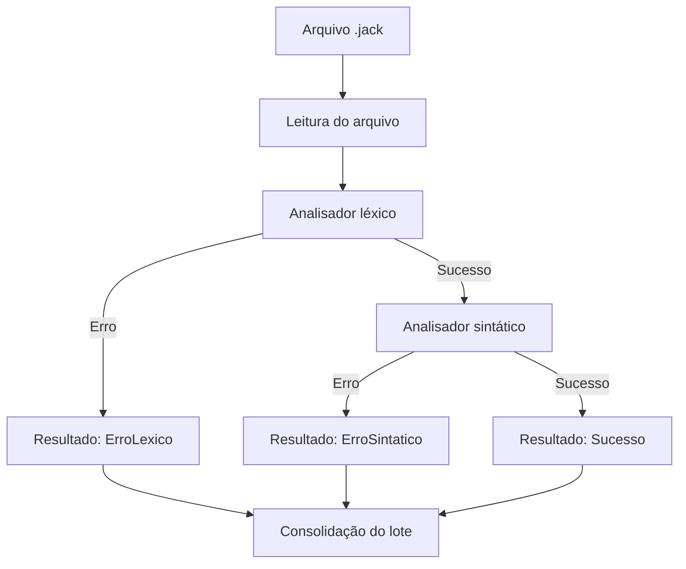

# Testes do JackCompiler

## 1. Objetivo

Este documento descreve a estratégia de testes funcionais utilizada no **JackCompiler**, a organização dos arquivos de entrada e o funcionamento das operações de teste disponibilizadas pela interface de linha de comando.

A estratégia atual utiliza arquivos `.jack` como entradas para verificar o comportamento conjunto do analisador léxico e do analisador sintático. Os resultados são comparados com o comportamento esperado para cada categoria de arquivo.

É importante distinguir esse mecanismo de um framework de testes unitários: a configuração atual do projeto não define GoogleTest, Catch2 ou outro framework equivalente, nem registra uma suíte de testes no CTest. Os testes documentados aqui são executados por meio da aplicação CLI.

## 2. Organização dos arquivos de teste

Os arquivos de entrada estão organizados em `tests/inputs`, separados em duas categorias:

```text
tests/
└── inputs/
    ├── validos/
    └── invalidos/
```

### 2.1 Arquivos válidos

A pasta `tests/inputs/validos` contém oito arquivos que devem ser aceitos tanto pelo analisador léxico quanto pelo analisador sintático.

| Arquivo |
|---|
| `teste_chamadas_output.jack` |
| `teste_condicional_e_chamada_funcao.jack` |
| `teste_full.jack` |
| `teste_if_else.jack` |
| `teste_limites_e_casos_especiais_1.jack` |
| `teste_parametros_validos.jack` |
| `teste_variaveis.jack` |
| `teste_variaveis_classe_static_field.jack` |

Os nomes indicam os temas que motivaram os casos de teste. A classificação como válido significa que, na execução da suíte, espera-se que o arquivo passe pelas duas etapas de análise.

### 2.2 Arquivos inválidos

A pasta `tests/inputs/invalidos` contém nove arquivos que devem ser rejeitados por pelo menos uma das etapas de análise.

| Arquivo |
|---|
| `teste_classe_incompleta.jack` |
| `teste_classe_sem_chave.jack` |
| `teste_classe_sem_fechamento.jack` |
| `teste_declaracao_fora_de_ordem.jack` |
| `teste_erro.jack` |
| `teste_expressao_invalida.jack` |
| `teste_if_sem_parentese.jack` |
| `teste_parametro_sem_tipo.jack` |
| `teste_var_sem_ponto_virgula.jack` |

Para essa categoria, é considerado resultado esperado que o arquivo apresente erro léxico ou, caso a análise léxica seja concluída com sucesso, erro sintático.

## 3. Critérios de aprovação

A suíte utiliza critérios diferentes para as duas categorias:

| Categoria do arquivo | Resultado esperado |
|---|---|
| `validos` | Análise léxica bem-sucedida e análise sintática bem-sucedida |
| `invalidos` | Erro léxico ou, se a análise léxica passar, erro sintático |

Um arquivo da categoria `validos` não é considerado aprovado se apenas a análise léxica for bem-sucedida: também é necessário que o parser aceite sua estrutura.

Para um arquivo da categoria `invalidos`, a ocorrência de erro léxico já corresponde ao resultado esperado. Se não houver erro léxico, a análise sintática deve rejeitar o arquivo.

Esses critérios verificam o comportamento das etapas implementadas. Eles não avaliam propriedades semânticas, pois o projeto ainda não possui uma etapa de análise semântica.

## 4. Execução da suíte pela interface CLI

A interface de linha de comando oferece a opção **8 — Executar testes**. Essa operação executa os arquivos das categorias `validos` e `invalidos` e compara os resultados obtidos com os critérios esperados.

Por padrão, a aplicação utiliza o diretório:

```text
tests/inputs
```

Esse caminho é definido a partir da raiz do projeto disponibilizada na compilação por meio da definição `JACK_PROJECT_ROOT`. Ao iniciar a operação, o usuário pode aceitar o diretório padrão pressionando Enter ou informar outro caminho.

O diretório informado deve conter as duas subpastas:

```text
validos/
invalidos/
```

Cada uma precisa conter pelo menos um arquivo `.jack`. A verificação é feita nos arquivos diretamente contidos nessas pastas; não há busca recursiva em subdiretórios.

### 4.1 Interpretação do resultado

Ao final da execução, a aplicação apresenta um resumo da suíte, incluindo a quantidade de arquivos processados e os resultados obtidos em relação ao esperado.

Um arquivo válido que falhe em qualquer uma das etapas é contabilizado como falha do teste. Um arquivo inválido que seja aceito pelas duas etapas também representa falha, pois seu resultado não corresponde ao esperado.

A operação também informa problemas de execução, como dificuldades para acessar ou ler arquivos e problemas na estrutura do diretório de testes.

## 5. Análise em lote de um diretório

Além da suíte organizada em categorias, a CLI oferece a opção **9 — Testar arquivos Jack em lote**.

Essa operação permite informar um diretório absoluto e analisar os arquivos `.jack` encontrados diretamente nele. Os arquivos são ordenados pelo nome antes do processamento. A busca não é recursiva: arquivos presentes em subdiretórios não são incluídos.

O resumo diferencia **arquivos encontrados** de **arquivos processados**. Todos os arquivos `.jack` localizados são contabilizados como encontrados. Um arquivo só é contabilizado como processado quando sua leitura é concluída com sucesso; arquivos que falham na abertura ou leitura entram na contagem de erros de leitura, mas não incrementam o total de arquivos processados.

Para cada arquivo encontrado, o componente de teste:

1. tenta abrir e ler o arquivo;
2. executa a análise léxica;
3. se a análise léxica for bem-sucedida, executa a análise sintática;
4. registra o resultado e as informações de erro disponíveis.

Se a leitura falhar, o arquivo é registrado com erro de leitura. Se a análise léxica falhar, o parser não é executado para aquele arquivo.

Essa operação é diferente da opção 8: ela não utiliza as categorias `validos` e `invalidos` nem compara o resultado com uma expectativa predefinida. Seu objetivo é apresentar o resultado das análises para todos os arquivos encontrados no diretório informado.

## 6. Componente `TestadorLote`

A execução em lote é implementada pelo componente `TestadorLote`, localizado na interface CLI.

O método público `executar` recebe o caminho do diretório a ser analisado e produz um `ResultadoLote`. O componente verifica se o caminho existe e corresponde a um diretório, localiza os arquivos regulares com extensão `.jack` diretamente nesse diretório e os processa em ordem alfabética.

### 6.1 Resultado por arquivo

Cada arquivo processado é representado por uma estrutura `ResultadoArquivo`, que reúne informações como:

- nome e caminho do arquivo;
- resultado da leitura;
- indicação de execução e validade da análise léxica;
- indicação de execução e validade da análise sintática;
- quantidade de tokens;
- mensagens e posições de erros léxicos ou sintáticos, quando existentes.

O resultado distingue as seguintes situações:

| Situação | Significado |
|---|---|
| `Sucesso` | Leitura, análise léxica e análise sintática concluídas com sucesso |
| `ErroLexico` | O arquivo foi lido, mas apresentou erro na análise léxica |
| `ErroSintatico` | A análise léxica passou, mas o parser encontrou erro |
| `ErroLeitura` | Não foi possível ler o arquivo |

### 6.2 Resultado consolidado

A estrutura `ResultadoLote` reúne os resultados individuais e os totais da execução. Entre as informações contabilizadas estão:

- arquivos encontrados e processados;
- arquivos aceitos;
- erros léxicos;
- erros sintáticos;
- erros de leitura;
- quantidade de tokens;
- quantidade de erros registrados.

O campo `totalArquivosEncontrados` registra a quantidade de arquivos `.jack` localizados no diretório. Já `totalArquivosProcessados` registra quantos deles tiveram a leitura concluída e, portanto, puderam seguir para a análise léxica. Um erro de leitura é contabilizado separadamente em `totalErroLeitura`.

A coleção `arquivos` mantém um resultado individual para cada arquivo encontrado, inclusive quando a leitura falha. Assim, a quantidade de entradas nessa coleção corresponde aos arquivos encontrados, enquanto o total de arquivos processados pode ser menor.

Os totais de sucesso, erros léxicos, erros sintáticos e erros de leitura representam categorias de resultado dos arquivos. As quantidades de tokens e de erros léxicos e sintáticos são contabilizadas separadamente. Na implementação atual, cada análise interrompida por erro registra o primeiro erro identificado naquela etapa.

Essa consolidação permite observar tanto o resultado de cada arquivo quanto o comportamento geral do conjunto analisado, sem confundir arquivos localizados com arquivos cuja leitura foi concluída.

## 7. Relação entre os testes e o núcleo do compilador

Os testes em lote exercitam o mesmo núcleo utilizado pelas interfaces do projeto:



O `TestadorLote` não implementa regras léxicas ou sintáticas próprias. Ele coordena a leitura dos arquivos e a chamada aos componentes do `jack_core`, registrando os resultados retornados por essas etapas.

A opção 8 da CLI acrescenta a comparação com as expectativas das categorias `validos` e `invalidos`. A opção 9 utiliza o processamento em lote para apresentar os resultados de um diretório arbitrário.

## 8. Limitações da estratégia atual

A estratégia atual oferece uma forma prática de verificar exemplos completos da linguagem, mas possui limites:

- os casos são arquivos de entrada completos, não testes unitários isolados de cada método ou classe;
- a busca por arquivos nas pastas de teste não é recursiva;
- a suíte depende da classificação manual dos arquivos nas categorias `validos` e `invalidos`;
- a categoria `invalidos` aceita tanto erro léxico quanto sintático, sem exigir que cada arquivo falhe em uma etapa específica;
- não há, atualmente, uma suíte de testes integrada ao CTest ou a um framework dedicado;
- não há testes específicos documentados para análise semântica ou geração de código VM, etapas que não estão implementadas.

Uma evolução possível é ampliar os casos de entrada e adicionar testes automatizados mais granulares para componentes individuais, mantendo os arquivos funcionais existentes como testes de integração das etapas léxica e sintática.

## 9. Recomendações para manutenção dos casos

Ao adicionar um arquivo de teste:

1. coloque-o em `validos` se a expectativa for que passe pelas análises léxica e sintática;
2. coloque-o em `invalidos` se a expectativa for que seja rejeitado por pelo menos uma dessas etapas;
3. utilize nomes que indiquem o aspecto da linguagem ou o tipo de erro exercitado;
4. mantenha os arquivos diretamente nas pastas correspondentes, pois a busca atual não percorre subdiretórios;
5. execute a opção 8 da CLI para verificar se os resultados correspondem à classificação esperada.

A classificação deve refletir o comportamento esperado do analisador, e não apenas a intenção de quem criou o exemplo. Se uma alteração na gramática fizer um arquivo passar ou falhar de maneira diferente, é necessário revisar o caso e sua categoria.

---

*Documento técnico referente à estratégia de testes funcionais atualmente disponível no JackCompiler.*
