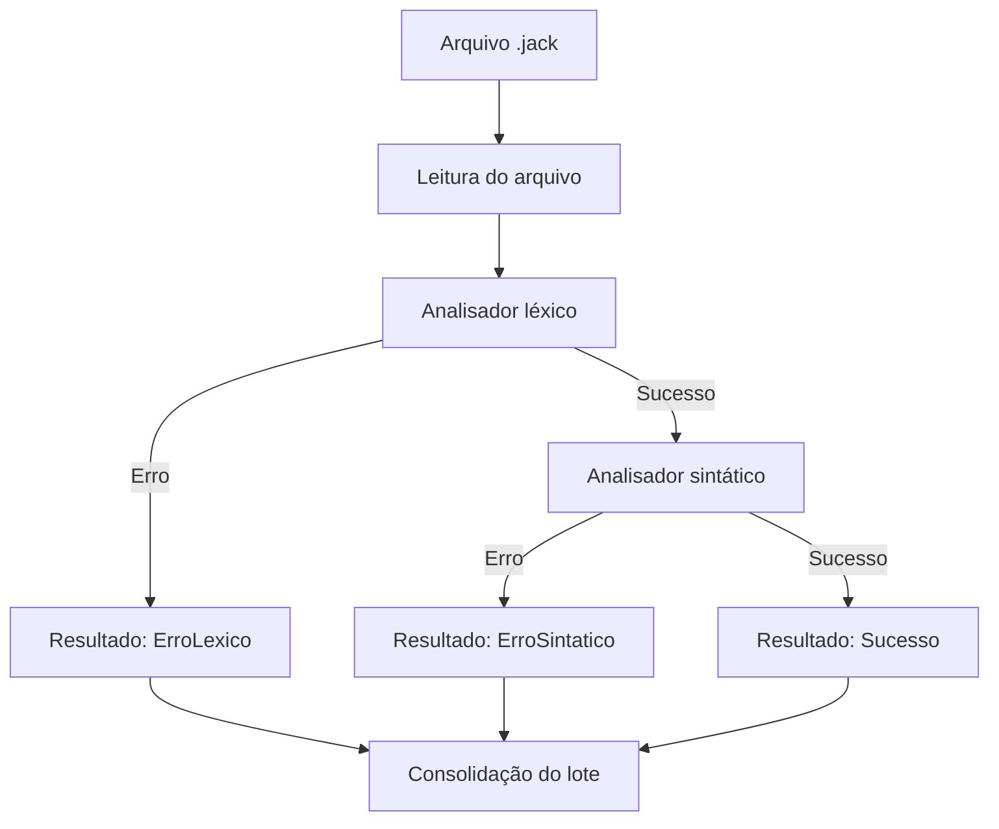

# Testes do JackCompiler

## 1. Objetivo

Este documento descreve a estratégia de testes do **JackCompiler**, incluindo os testes funcionais por arquivos `.jack`, os testes independentes dos componentes `SymbolTable`, `VMWriter` e `VMCodeGenerator`, a validação funcional da geração de código VM integrada à CLI e os testes de regressão e avaliação funcional do Comparador XML.

Os testes por arquivos verificam o comportamento conjunto do analisador léxico e do analisador sintático. Os testes independentes exercitam comportamentos específicos dos componentes do núcleo. A validação funcional integrada da geração VM utiliza os seis programas oficiais do Project 11 do Nand2Tetris. O Comparador XML possui um alvo opcional de regressão integrado ao CTest; os demais testes independentes de componentes não estão integrados a frameworks como GoogleTest ou Catch2.

## 2. Organização dos arquivos de teste

Os arquivos de entrada estão organizados em `tests/inputs`, separados em duas categorias:

```text
tests/
└── inputs/
    ├── validos/
    └── invalidos/
```

### 2.1 Arquivos válidos

Na coleta registrada em 20/11/2026, a pasta `tests/inputs/validos` continha oito arquivos que deveriam ser aceitos tanto pelo analisador léxico quanto pelo analisador sintático. Esse inventário não foi reconfirmado no checkout da fase VMCodeGenerator.

| Arquivo |
|---|
| `teste_chamadas_output.jack` |
| `teste_condicional_e_chamada_funcao.jack` |
| `teste_full.jack` |
| `teste_if_else.jack` |
| `teste_limites_e_casos_especiais_1.jack` |
| `teste_parametros_validos.jack` |
| `teste_variaveis.jack` |
| `teste_variaveis_classe_static_field.jack` |

Os nomes indicam os temas que motivaram os casos de teste. A classificação como válido significa que, na execução da suíte, espera-se que o arquivo passe pelas duas etapas de análise.

### 2.2 Arquivos inválidos

Na mesma coleta de 20/11/2026, a pasta `tests/inputs/invalidos` continha nove arquivos que deveriam ser rejeitados por pelo menos uma das etapas de análise. Esse inventário não foi reconfirmado no checkout da fase VMCodeGenerator.

| Arquivo |
|---|
| `teste_classe_incompleta.jack` |
| `teste_classe_sem_chave.jack` |
| `teste_classe_sem_fechamento.jack` |
| `teste_declaracao_fora_de_ordem.jack` |
| `teste_erro.jack` |
| `teste_expressao_invalida.jack` |
| `teste_if_sem_parentese.jack` |
| `teste_parametro_sem_tipo.jack` |
| `teste_var_sem_ponto_virgula.jack` |

Para essa categoria, é considerado resultado esperado que o arquivo apresente erro léxico ou, caso a análise léxica seja concluída com sucesso, erro sintático.

## 3. Critérios de aprovação

A suíte utiliza critérios diferentes para as duas categorias:

| Categoria do arquivo | Resultado esperado |
|---|---|
| `validos` | Análise léxica bem-sucedida e análise sintática bem-sucedida |
| `invalidos` | Erro léxico ou, se a análise léxica passar, erro sintático |

Um arquivo da categoria `validos` não é considerado aprovado se apenas a análise léxica for bem-sucedida: também é necessário que o parser aceite sua estrutura.

Para um arquivo da categoria `invalidos`, a ocorrência de erro léxico já corresponde ao resultado esperado. Se não houver erro léxico, a análise sintática deve rejeitar o arquivo.

Esses critérios verificam exclusivamente o comportamento léxico e sintático dos arquivos dessa suíte. Eles não representam os critérios dos testes de `SymbolTable`, `VMWriter` ou `VMCodeGenerator`, descritos adiante.

## 4. Execução da suíte pela interface CLI

A interface de linha de comando oferece a opção **8 — Executar testes**. Essa operação executa os arquivos das categorias `validos` e `invalidos` e compara os resultados obtidos com os critérios esperados.

Por padrão, a aplicação utiliza o diretório:

```text
tests/inputs
```

Esse caminho é definido a partir da raiz do projeto disponibilizada na compilação por meio da definição `JACK_PROJECT_ROOT`. Ao iniciar a operação, o usuário pode aceitar o diretório padrão pressionando Enter ou informar outro caminho.

O diretório informado deve conter as duas subpastas:

```text
validos/
invalidos/
```

Cada uma precisa conter pelo menos um arquivo `.jack`. A verificação é feita nos arquivos diretamente contidos nessas pastas; não há busca recursiva em subdiretórios.

### 4.1 Interpretação do resultado

Ao final da execução, a aplicação apresenta um resumo da suíte, incluindo a quantidade de arquivos processados e os resultados obtidos em relação ao esperado.

Um arquivo válido que falhe em qualquer uma das etapas é contabilizado como falha do teste. Um arquivo inválido que seja aceito pelas duas etapas também representa falha, pois seu resultado não corresponde ao esperado.

A operação também informa problemas de execução, como dificuldades para acessar ou ler arquivos e problemas na estrutura do diretório de testes.

## 5. Análise em lote de um diretório

Além da suíte organizada em categorias, a CLI oferece a opção **9 — Testar arquivos Jack em lote**.

Essa operação permite informar um diretório absoluto e analisar os arquivos `.jack` encontrados diretamente nele. Os arquivos são ordenados pelo nome antes do processamento. A busca não é recursiva: arquivos presentes em subdiretórios não são incluídos.

O resumo diferencia **arquivos encontrados** de **arquivos processados**. Todos os arquivos `.jack` localizados são contabilizados como encontrados. Um arquivo só é contabilizado como processado quando sua leitura é concluída com sucesso; arquivos que falham na abertura ou leitura entram na contagem de erros de leitura, mas não incrementam o total de arquivos processados.

Para cada arquivo encontrado, o componente de teste:

1. tenta abrir e ler o arquivo;
2. executa a análise léxica;
3. se a análise léxica for bem-sucedida, executa a análise sintática;
4. registra o resultado e as informações de erro disponíveis.

Se a leitura falhar, o arquivo é registrado com erro de leitura. Se a análise léxica falhar, o parser não é executado para aquele arquivo.

Essa operação é diferente da opção 8: ela não utiliza as categorias `validos` e `invalidos` nem compara o resultado com uma expectativa predefinida. Seu objetivo é apresentar o resultado das análises para todos os arquivos encontrados no diretório informado.

## 6. Componente `TestadorLote`

A execução em lote é implementada pelo componente `TestadorLote`, localizado na interface CLI.

O método público `executar` recebe o caminho do diretório a ser analisado e produz um `ResultadoLote`. O componente verifica se o caminho existe e corresponde a um diretório, localiza os arquivos regulares com extensão `.jack` diretamente nesse diretório e os processa em ordem alfabética.

### 6.1 Resultado por arquivo

Cada arquivo encontrado é representado por uma estrutura `ResultadoArquivo`, que reúne informações como:

- nome e caminho do arquivo;
- resultado da leitura;
- indicação de execução e validade da análise léxica;
- indicação de execução e validade da análise sintática;
- quantidade de tokens;
- mensagens e posições de erros léxicos ou sintáticos, quando existentes.

O resultado distingue as seguintes situações:

| Situação | Significado |
|---|---|
| `Sucesso` | Leitura, análise léxica e análise sintática concluídas com sucesso |
| `ErroLexico` | O arquivo foi lido, mas apresentou erro na análise léxica |
| `ErroSintatico` | A análise léxica passou, mas o parser encontrou erro |
| `ErroLeitura` | Não foi possível ler o arquivo |

### 6.2 Resultado consolidado

A estrutura `ResultadoLote` reúne os resultados individuais e os totais da execução. Entre as informações contabilizadas estão:

- arquivos encontrados e processados;
- arquivos aceitos;
- erros léxicos;
- erros sintáticos;
- erros de leitura;
- quantidade de tokens;
- quantidade de erros registrados.

O campo `totalArquivosEncontrados` registra a quantidade de arquivos `.jack` localizados no diretório. Já `totalArquivosProcessados` registra quantos deles tiveram a leitura concluída e, portanto, puderam seguir para a análise léxica. Um erro de leitura é contabilizado separadamente em `totalErroLeitura`.

A coleção `arquivos` mantém um resultado individual para cada arquivo encontrado, inclusive quando a leitura falha. Assim, a quantidade de entradas nessa coleção corresponde aos arquivos encontrados, enquanto o total de arquivos processados pode ser menor.

Os totais de sucesso, erros léxicos, erros sintáticos e erros de leitura representam categorias de resultado dos arquivos. As quantidades de tokens e de erros léxicos e sintáticos são contabilizadas separadamente. Na implementação atual, cada análise interrompida por erro registra o primeiro erro identificado naquela etapa.

Essa consolidação permite observar tanto o resultado de cada arquivo quanto o comportamento geral do conjunto analisado, sem confundir arquivos localizados com arquivos cuja leitura foi concluída.

## 7. Relação entre os testes funcionais e o núcleo do compilador

Os testes funcionais em lote exercitam o fluxo léxico e sintático do núcleo utilizado pelas interfaces do projeto:



O `TestadorLote` não implementa regras léxicas ou sintáticas próprias. Ele coordena a leitura dos arquivos e a chamada aos componentes do `jack_core`, registrando os resultados retornados por essas etapas.

A opção 8 da CLI acrescenta a comparação com as expectativas das categorias `validos` e `invalidos`. A opção 9 utiliza o processamento em lote para apresentar os resultados de um diretório arbitrário.

## 8. Testes dos componentes e validação da geração VM

Além dos testes funcionais por arquivos, foram realizados testes independentes de `SymbolTable`, `VMWriter` e `VMCodeGenerator`, além de validação funcional da geração VM integrada à CLI.

### 8.1 `SymbolTable`

A `SymbolTable` foi compilada e testada independentemente, com GCC 13.1.0 e C++17, sem alterações no CMake de produção.

Foram aprovados oito cenários:

- separação de escopos;
- indexação independente;
- reserva do índice zero de argumentos para métodos;
- reinicialização dos escopos de sub-rotina e classe;
- precedência entre escopos;
- identificação de declarações duplicadas;
- consultas a identificadores inexistentes;
- consultas e resolução de identificadores.

**Resultado registrado: 8/8 cenários aprovados.**

Essa validação cobre os comportamentos exercitados pelos cenários descritos; não comprova, isoladamente, a existência de uma etapa completa de análise semântica nem a integração com todos os fluxos do parser.

### 8.2 `VMWriter`

O `VMWriter` foi compilado e testado independentemente, com GCC 13.1.0 e C++17, também sem alterações no CMake de produção.

Foram aprovados 14 cenários, abrangendo:

- instruções `push` e `pop`;
- os nove comandos aritméticos e lógicos (`add`, `sub`, `neg`, `eq`, `gt`, `lt`, `and`, `or` e `not`);
- rejeição de comandos desconhecidos;
- geração de labels, `goto` e `if-goto`;
- geração de `call`, `function` e `return`;
- rejeição de `pop constant`;
- limites dos segmentos `pointer`, `temp`, `static` e `constant`;
- índices negativos e nomes inválidos;
- quantidades negativas;
- finalização e comportamento idempotente;
- tentativa de escrita após finalização;
- falhas de escrita e de `flush`/finalização.

**Resultado registrado: 14/14 cenários aprovados.**

Os limites exercitados foram: `pointer` 0–1, `temp` 0–7, `static` 0–239 e `constant` 0–32767.

### 8.3 `VMCodeGenerator` — testes independentes do componente

O projeto contém dois programas de teste específicos do gerador:

- `tests/vmcodegenerator_tests.cpp`;
- `tests/vmcodegenerator_extended_tests.cpp`.

As notas de implementação registram a compilação e a execução desses programas separadamente, com GCC, C++17 e as opções `-Wall -Wextra -Wpedantic`, junto às implementações de AST, `SymbolTable`, `VMWriter` e `VMCodeGenerator`.

Os testes constroem ASTs diretamente e exercitam tradução básica, associação entre nós da AST, construtores, métodos, arrays, strings, chamadas e falha sem publicação de conteúdo parcial. As notas disponíveis não apresentam uma contagem consolidada de casos nem a transcrição dos resultados de execução; por isso, este documento não atribui a esses testes um total de aprovações.

Essa execução independente não comprova, por si só, a integração com parser, CLI ou CMake. As notas de implementação registram que o CMake completo e a CLI não foram configurados naquele ambiente isolado, pois o pacote disponibilizado não continha todos os fontes necessários. A integração com a CLI foi validada separadamente, conforme a seção seguinte.

### 8.4 `VMCodeGenerator` e integração funcional com a CLI

A geração VM e sua integração com a CLI foram submetidas a validação
utilizando os seis programas oficiais do Project 11 do Nand2Tetris:

- Seven;
- Average;
- ComplexArrays;
- ConvertToBin;
- Pong;
- Square.

Na regressão Windows W-12, o Testador registrou 11 arquivos-fonte
Jack distribuídos pelos seis projetos. Todos os diretórios foram compilados
com código de saída zero e produziram a quantidade esperada de arquivos
VM.

| Projeto | Arquivos Jack | Arquivos VM esperados/gerados | Resultado |
|---|---:|---:|---|
| Seven | 1 | 1/1 | PASS |
| ConvertToBin | 1 | 1/1 | PASS |
| Square | 3 | 3/3 | PASS* |
| Average | 1 | 1/1 | PASS |
| Pong | 4 | 4/4 | PASS |
| ComplexArrays | 1 | 1/1 | PASS |
| **Total** | **11** | **11/11** | **PASS** |

\* Em Square, `PASS` indica que os três arquivos Jack foram compilados e
os três arquivos VM esperados foram gerados. Na avaliação funcional, a
movimentação foi aprovada, mas o redimensionamento não funcionou; essa
limitação também foi observada com o compilador oficial, conforme
detalhado na ressalva abaixo.

Os arquivos foram executados no VM Emulator desktop. Os resultados
funcionais registrados foram:

| Programa | Resultado observado |
|---|---|
| Seven | Saída `7`; aprovado. |
| ConvertToBin | Os 16 bits da representação binária de 8001 foram verificados em `RAM[8001..8016]`; aprovado. |
| Average | Com entradas 10, 20 e 30, apresentou `Average is 20`; aprovado. |
| ComplexArrays | Os cinco resultados observados (5, 40, 0, 77 e 110) corresponderam aos esperados; aprovado. |
| Pong | O responsável informou que todos os testes funcionaram no VM Emulator desktop; aprovado conforme relato e evidências encaminhadas. |
| Square | O quadrado respondeu aos comandos direcionais; movimentação aprovada. Os comandos de redimensionamento não funcionaram. |

**Ressalva de Square:** o comportamento de redimensionamento também
foi reproduzido com o compilador oficial do Nand2Tetris no emulador
online, conforme comparação relatada anteriormente pelo Desenvolvedor.
Não há evidência para classificar essa limitação como defeito confirmado
do JackCompiler.

A avaliação concluiu que não foram identificadas regressões funcionais
na geração VM associadas às alterações do Comparador XML, dentro dos
projetos e cenários avaliados. Isso não constitui prova de correção de
todas as construções da linguagem Jack.

### 8.5 Limites da cobertura documentada

As validações descritas neste documento possuem escopos distintos:

- os arquivos de `tests/inputs/validos` e `tests/inputs/invalidos` verificam o fluxo léxico e sintático;
- os testes independentes de `SymbolTable` e `VMWriter` verificam comportamentos específicos desses componentes;
- os testes independentes de `VMCodeGenerator` exercitam a tradução de ASTs construídas diretamente, sem substituir a validação integrada;
- a compilação dos seis programas Project 11 verifica a integração da geração VM com a CLI; a execução no emulador verifica apenas os cenários funcionais descritos;
- os testes do Comparador XML verificam os casos automatizados de DTD e os cenários funcionais explicitamente relacionados na seção seguinte.

Não se deve interpretar os resultados como cobertura exaustiva de todos os comandos, expressões, chamadas, tipos ou situações da linguagem Jack. Também não comprovam uma etapa independente e completa de análise semântica.

Os testes independentes dos componentes foram compilados e executados fora do CMake de produção, exceto pelo alvo opcional de regressão do Comparador XML, descrito adiante. Os registros não demonstram integração desses executáveis independentes ao GoogleTest ou Catch2.

### 8.6 Comparador XML — regressão automatizada

O projeto inclui o teste `tests/comparadorxml_regression_tests.cpp`, disponibilizado por meio da opção CMake `BUILD_XML_COMPARATOR_REGRESSION_TESTS`, desativada por padrão.

Quando habilitada, a configuração cria o alvo `comparadorxml_regression_tests` e registra um teste no CTest. O conjunto automatizado contém quatro casos:

1. a sequência `<!DOCTYPE fake>` dentro de comentário deve ser aceita;
2. a sequência `<!DOCTYPE fake>` dentro de CDATA deve ser aceita como conteúdo;
3. um DTD efetivo no XML de referência deve ser rejeitado;
4. um DTD efetivo no XML gerado, inclusive com identificador externo, deve ser rejeitado.

Comandos registrados para configurar, compilar e executar os testes no Windows:

```powershell
cmake -S . -B build-cli -DBUILD_GUI=OFF -DBUILD_XML_COMPARATOR_REGRESSION_TESTS=ON
cmake --build build-cli --target jack_cli comparadorxml_regression_tests
ctest --test-dir build-cli --output-on-failure
```

Na execução registrada em 28/11/2026, os alvos `jack_pugixml`,
`jack_core`, `jack_cli` e `comparadorxml_regression_tests` foram
compilados com sucesso. O CTest apresentou **1/1 teste aprovado**. Esse
único teste registrado agrupa os quatro casos descritos; não significa
que toda a suíte de testes do projeto tenha sido executada pelo CTest.

### 8.7 Comparador XML — avaliação funcional no Windows

A avaliação funcional foi consolidada pelo Testador em 28/11/2026,
abrangendo as opções interativas 10 e 11, os defeitos DEF-XML-01 e
DEF-XML-02, a distribuição Windows e a regressão VM W-12.

A proveniência deve ser preservada: o relatório do Testador informa que
os cenários identificados W-00 a W-13 foram executados pelo responsável
no computador Windows e apresentados ao Testador por transcrições,
saídas e evidências. Não descrever esses testes como execução direta do
Testador. W-00 identifica especificamente a inicialização da CLI no
ambiente Windows independente. A validação geral da distribuição não
possui identificador individual próprio. W-13 identifica exclusivamente
o teste de falha de permissão de leitura do arquivo XML gerado.

#### Resultados do Comparador XML

| Cenário | Resultado |
|---|---|
| W-00 — Inicialização da CLI em Windows independente, sem ferramentas de desenvolvimento | PASS |
| Comparação léxica de ArrayTest | PASS — documentos equivalentes |
| Comparação sintática de ArrayTest | PASS — documentos equivalentes |
| Caminhos contendo espaços | PASS |
| Arquivo de referência inexistente | PASS — erro específico |
| Arquivo gerado inexistente | PASS — erro específico |
| Diretório informado no lugar do arquivo de referência | PASS — rejeitado como não sendo arquivo regular |
| XML malformado | PASS — diagnóstico com linha e coluna |
| Raiz XML incompatível | PASS |
| Retorno ao menu após comparação ou erro | PASS |
| Repetição das exportações léxica e sintática | PASS |
| Comentário, CDATA e DTD efetivo | PASS |
| Falha real de permissão de leitura do arquivo gerado (W-13) | PASS |

**DEF-XML-01 — nomes distintos dos XML exportados:** aprovado. As
exportações léxica e sintática produzem, respectivamente,
`Nome_lexico.xml` e `Nome_sintatico.xml`, evitando colisão e
sobrescrita entre os dois documentos.

**DEF-XML-02 — identificação de DTD:** aprovado. A sequência
`<!DOCTYPE fake>` dentro de comentário ou CDATA é aceita; uma declaração
DTD efetiva é rejeitada. O parser não deve resolver entidades ou
recursos externos.

A falha real de permissão W-13 foi demonstrada para o arquivo XML
gerado: a aplicação informou que não conseguiu abrir o arquivo,
permaneceu funcional e retornou ao menu. O relatório não demonstra o
mesmo teste de permissão negada para o arquivo de referência.

#### Distribuição Windows independente — validação sem ID próprio

A validação geral da distribuição Windows não possui identificador
individual de teste. O cenário W-00 registra especificamente a
inicialização da CLI no ambiente independente. O pacote contendo
`jack_cli.exe` e `libwinpthread-1.dll` foi executado em outro computador
com Windows 11, sem instalação de Qt, CMake ou MinGW. O executável
iniciou e executou os cenários avaliados.

O resultado valida o pacote no ambiente específico testado. Não deve
ser generalizado para todas as versões, arquiteturas ou configurações
possíveis do Windows. O relatório não apresenta hash coletado no
computador independente para comparação criptográfica com o binário
originalmente encaminhado.

#### Proveniência e limites

- O pacote recebido pelo Testador foi identificado por SHA-256
  `13eb2172364e208cca062400e4ac6216ae7958e93f4d9f6149fd59944ae790e3`.
  Esse hash identifica o ZIP recebido, não o commit Git nem o código-fonte.
- Não foi fornecido commit/hash Git correspondente ao executável
  avaliado.
- O cenário de diretório no lugar de arquivo foi demonstrado no campo
  do XML de referência; não foi apresentado o mesmo caso no campo do
  XML gerado.
- O teste de permissão negada foi demonstrado para o arquivo gerado,
  não para o arquivo de referência.
- A aprovação é limitada à versão/pacote e aos cenários efetivamente
  avaliados; não garante ausência de defeitos.


## 9. Recomendações para manutenção dos casos

Ao adicionar um arquivo de teste:

1. coloque-o em `validos` se a expectativa for que passe pelas análises léxica e sintática;
2. coloque-o em `invalidos` se a expectativa for que seja rejeitado por pelo menos uma dessas etapas;
3. utilize nomes que indiquem o aspecto da linguagem ou o tipo de erro exercitado;
4. mantenha os arquivos diretamente nas pastas correspondentes, pois a busca atual não percorre subdiretórios;
5. execute a opção 8 da CLI para verificar se os resultados correspondem à classificação esperada;
6. ao alterar `SymbolTable`, `VMWriter` ou `VMCodeGenerator`, execute também os testes específicos correspondentes e registre separadamente seus resultados.

A classificação deve refletir o comportamento esperado do analisador, e não apenas a intenção de quem criou o exemplo. Se uma alteração na gramática fizer um arquivo passar ou falhar de maneira diferente, é necessário revisar o caso e sua categoria.

---

*Documento técnico referente à estratégia de testes funcionais atualmente disponível no JackCompiler.*
